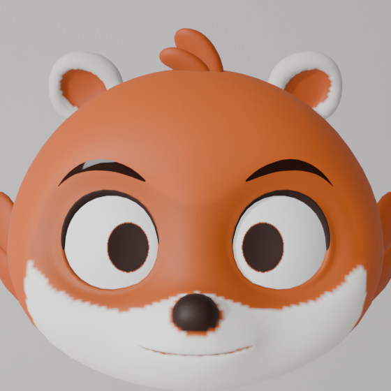

# 照片 → 可被摄像头驱动的 3D 头像（Blender + aniface）

把一张**参考图**变成能在浏览器里用**摄像头实时驱动**的 3D 头像：模型带完整的 ARKit 52 表情
（morph target），由 MediaPipe 识别人脸后驱动。

项目包含**两条建模流水线**（真人头像 / 卡通动物头像）、一个**开箱即用的网页演示**，
以及一份把两次实践中所有坑记录下来的工程笔记。

<p align="center">
  
  &nbsp;&nbsp;➜&nbsp;&nbsp;
  
  <br>
  <sub>参考图 ➜ 程序化生成的 <code>redpanda_head.glb</code>（52 个 ARKit 表情，0.84 MB）</sub>
</p>

---

## 这是什么

一条完整链路：

```
参考图 / 照片
   │  ← Blender + MCP（由 Codex 等 agent 直接驱动）
   ▼
带 ARKit 命名 morph target 的 GLB
   │  ← three.js + aniface 运行时
   ▼
摄像头 → MediaPipe FaceLandmarker → ARKit 52 blendshape → 模型表情
```

关键约束：**模型的 morph target 必须按 ARKit 命名**（大小写敏感、名字精确匹配），
否则 aniface 只会让头转动，脸是死的。

## 站在谁的肩膀上

本项目不是一个从零开始的模型库，而是在两个成熟上游之上做**工程化补齐**。
下面说清楚「谁给了什么」和「我们补了什么」。

### 上游项目

| 上游 | 提供 | 许可 |
|---|---|---|
| [ICT-FaceKit](https://github.com/USC-ICT/ICT-FaceKit)（USC ICT） | 真人头基座：26,719 顶点、UV 完整、53 个 ARKit 命名 shape key | MIT |
| [aniface](https://github.com/alysachan830/aniface)（Alysa Chan） | 运行时：MediaPipe FaceLandmarker → ARKit 52 blendshape → three.js morph | MIT |
| aniface 的 demo 素材 `raccoon_head_small.glb` | 卡通基座（自带 52 个 ARKit 表情，含 `tongueOut`） | MIT |
| `mcp-for-blender` | 让 agent 直接驱动 Blender 建模 / 渲染 / 导出 | MIT |

### 我们在 ICT-FaceKit 基础上做的（流水线 A：真人照片 → 人头）

ICT-FaceKit 只给你「模型 + 形状基」，**不会告诉你怎么从一张照片得到你的脸**。
下面这些是补上的部分：

1. **2D→3D 身份拟合**：MediaPipe 468 关键点 → 人工校验过的 29 个语义对应点 →
   60 个 PCA 模式 + 相似变换，交替最小二乘 + 岭回归求解身份系数
   （结果 `|c|=3.0`，重投影 RMSE 22.9 px ≈ 脸宽 5%）
2. **正确的 shape key 写入方式**：有 shape key 的网格改 `mesh.vertices` 无效，
   必须把增量写进**每一个 shape key 块**
3. **姿态规整**：法线重算朝外（贴图覆盖面 1894 → 7882 面）、统一缩放居中（头高 0.26 m）
4. **命名对齐**：`_L`→`Left`、`_R`→`Right` 等重命名，合并到 51 个精确 ARKit 名（缺 `tongueOut`）
5. **瘦身导出**：剔除眼球 / 牙齿 / 牙龈 / 睫毛（26,719 → 14,062 顶点）+ 关 morph 法线
   + meshopt 压缩 → **97.7 MB → 20.2 MB**
6. **一键复现**：以上步骤串成 `pipeline.py`，在 Blender 里一行 `exec()` 跑完

### 我们在 aniface 基础上做的（接入层 + 缺陷绕过）

aniface 的 head-only 模式有几处「不看源码必然踩」的行为，本项目都做了处理并写进文档：

| 上游行为 | 后果 | 我们的处理 |
|---|---|---|
| head-only 分支把模型矩阵**放大 40 倍** | Scale 要调到 0.1 才看得见，且只剩一张大嘴 | 读内层实际缩放并抵消：`wrapper.scale = 用户Scale / innerScale` |
| 内部已镜像 Y/Z，合成时又翻一次 → 双重镜像 | 模型动作与人脸左右相反 | `pasteMirror = !viewMirror` |
| 把人脸矩阵的**平移分量写进模型根节点** | 模型在画布内跑偏、被裁成半张脸 | 每帧在 render **之前**清零 `matrix.elements[12..14]` |
| 每帧覆盖 `gltf.scene.matrix` | 直接改模型位置 / 缩放无效 | 外套一层 `THREE.Group`，改 wrapper |

### 完全由本项目新增的部分

- **卡通动物头像流水线**（流水线 B）：基于 raccoon 基座的配色重映射方案
- **`aniface-demo`**：三视图网页演示（见下），上游只有一个「把模型摆在你脸上」的最小 demo
- **背景虚化 / 选区裁剪 / 圆角圆形蒙版**等合成与输出能力
- **GitHub Pages 子路径部署**（CI 构建 + 自动发布）
- **工程笔记 `AGENTS.md`**：30+ 条实测踩坑，含失败方案的复盘

## 在线演示

推送到 GitHub 后由 Actions 自动构建并发布到 `https://<用户名>.github.io/<仓库名>/`。
**GitHub Pages 自带 HTTPS，因此别人打开网页就能直接授权摄像头驱动头像**，不需要自签证书。

```powershell
cd C:\Users\Zouyu\tmp\blender
git remote add origin https://github.com/<用户名>/<仓库名>.git
git push -u origin main
```

Pages 开关不用手动点（`configure-pages` 带 `enablement: true` 会自动开启）。
细节见 [aniface-demo/README.md](aniface-demo/README.md#部署到-github-pages) 与
[.github/workflows/deploy-pages.yml](.github/workflows/deploy-pages.yml)。

## 快速开始

```powershell
cd aniface-demo
npm install
npm run dev            # 默认 HTTPS，打开 https://localhost:5199/
```

跨机器用摄像头（需要 https，且本机 IP 变了要重签证书）：

```powershell
npm run cert           # 把当前所有网卡 IP 写进 SAN
npm run dev
# 在另一台机器打开 https://<本机IP>:5199/
```

## 演示程序能做什么

三栏布局，控件跟着各自的视图走：

| 视图 | 能力 |
|---|---|
| **① 摄像头原始画面** | 关键点 / 网格叠加、镜像、实时信息；**背景虚化**（Selfie Segmenter，强度可调 + 反转遮罩） |
| **② 合成视图** | 把小熊猫按人脸框 **AR 贴到真人脸上**，大小 / 偏移 X、Y 可调 |
| **③ 输出视图** | **选区裁剪 × 倍率**得到任意分辨率输出；**蒙版**支持圆角矩形 / 圆形 + 边缘羽化 |

另有：3D 模型源切换、模型自身的位置 / 缩放 / 旋转、手动表情滑块（验证模型）、
文件测试模式（**不需要摄像头**，选本地视频或图片即可跑通整条链路）。

所有滑块都支持**鼠标滚轮调节**（`Shift` 粗调 10×、`Alt` 微调 1/10）。

```powershell
npm run check              # 自检：main.js 里所有 $('id') 是否都能在 index.html 找到
npm run vendor:mediapipe   # 把 MediaPipe 运行时本地化（约 36MB，避免依赖 CDN）
```

## 产物

| 文件 | 说明 |
|---|---|
| `redpanda_head.glb` | ★ 小熊猫头像，52 个 ARKit 表情，head-only，meshopt 压缩，**0.84 MB** |
| `aniface-demo/public/redpanda_head.glb` | 同一模型（演示用副本） |
| `redpanda_only.blend` | ★ 小熊猫 Blender 源工程 · 干净版（1.88 MB，开箱可渲染） |
| `redpanda_source.blend` | 小熊猫源工程 · 实验全场景（8.8 MB，含 53 个 shape key） |
| `raccoon_head_small.glb` | 上游卡通基座（MIT），流水线 B 的输入 |
| `redpanda_base3.png` / `redpanda_ear3.png` | 重映射生成的主体 / 耳朵贴图 |
| `final_f.png` / `redpanda_only_preview.png` | 最终渲染 |

校验和与归档说明见 [archive/CHECKSUMS.md](archive/CHECKSUMS.md)。

## 两条流水线怎么做

### 流水线 A：真人照片 → 人头（ICT-FaceKit）

```python
# 在 Blender（已装 mcp-for-blender）里执行
exec(open(r"pipeline.py", encoding="utf-8").read())
```

需要：`ICT-FaceKit/` 已 clone、`ict_fit.json`、
`ict_neutral.npy` / `ict_ids.npy`（由 `fit3.py` 生成）、一张正面照片。

```bash
git clone --depth 1 https://github.com/USC-ICT/ICT-FaceKit.git
```

### 流水线 B：卡通动物头像（以小熊猫为例）

1. 取 `raccoon_head_small.glb` 作基座（自带 52 个 ARKit 表情）
2. **配色重映射**：按亮度分区把原贴图换成目标色板
   —— 深 → 深红棕（眼罩 / 鼻）、中 → 锈橘（主体）、浅 → 奶白（吻 / 耳缘）
3. 耳朵单独一套贴图（白边 + 橘心）
4. 导出：meshopt + 关 morph 法线 → 0.84 MB

> 为什么不做照片投影？**把带表情的照片平面投影到模型上，会把舌头、张口、光照烤进中性表情**，
> 球面投影还会把眼周拉变形。做中性基座必须用**贴图配色重映射**这条稳的路子。
> 这个方案曾被采用又回退，复盘见 [docs/STATUS.md](docs/STATUS.md)。

## 目录结构

```
.
├── aniface-demo/              可运行的演示（Vite + three.js + MediaPipe）
│   ├── src/main.js            三种驱动模式 + 合成 + 虚化 + 选区输出
│   ├── public/redpanda_head.glb
│   ├── scripts/               vendor:mediapipe / make-cert / check-ids
│   └── README.md              界面说明 · 操作技巧 · 排错
│
├── .github/workflows/         GitHub Pages 构建与发布
├── pipeline.py                ★ 真人头像一键重建
├── fit3.py / mp_lm.py         MediaPipe 关键点 → ICT 身份系数拟合
├── rp_*.py                    小熊猫制作过程脚本（逐版本迭代留档）
├── glb_verify.py              GLB 规格校验（morph 名 / 压缩 / 骨骼）
│
├── AGENTS.md                  ★ 工程笔记：30+ 条实测踩坑与硬约束（动手前先读）
├── docs/STATUS.md             当前问题清单 + 两条流水线的完整步骤
└── archive/CHECKSUMS.md       产物 SHA256 与归档说明
```

## 已知不足

| 问题 | 说明 |
|---|---|
| **精细斑纹做不出来** | 基座贴图脸岛仅约 100×140 px 且左右镜像共用 UV，按 3D 坐标绘制分辨率不够。正解是重展 UV 到 1K~2K 后手工绘制 |
| 耳朵是侧向的 | 继承自 raccoon，真小熊猫是直立耳 |
| 人类头像缺 `tongueOut` | 卡通版本有，人类版本缺 |
| 人类头像脸型偏窄长 | 仅 29 个 2D 约束、无深度约束，线性模型拟合不到 100% |
| 无身体、无耳朵 / 尾巴骨骼 | aniface 只管脸 + 头旋转 |
| 实时链路未端到端验证 | 开发机无摄像头，需在另一台机器用 https 打开 |

具体路径与优先级见 [docs/STATUS.md](docs/STATUS.md)。

## 许可与致谢

- 上游 [ICT-FaceKit](https://github.com/USC-ICT/ICT-FaceKit)、[aniface](https://github.com/alysachan830/aniface)、
  `mcp-for-blender` 均为 **MIT**，本项目对其的使用与二次开发遵循各自许可
- `rpm_avatar.glb`（Ready Player Me 全身像）仅作参考对比，遵循 Ready Player Me 条款
- 本仓库**尚未附带自己的 LICENSE**；若要公开发布建议补一个（如 MIT）
- 仓库不包含任何真人照片素材；演示请用「用视频 / 图片文件测试」自选本地文件
